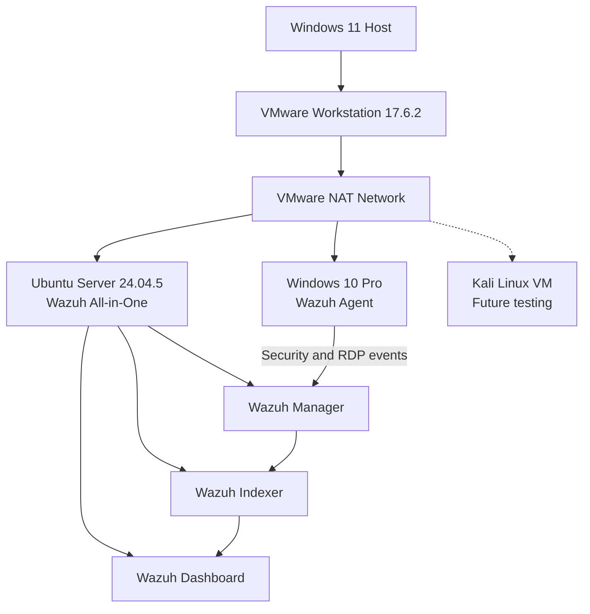

# Virtual SOC Lab – Wazuh SIEM and Windows Endpoint Monitoring

## Project Overview

This project is a home SOC lab built using VMware Workstation. It demonstrates the deployment of Wazuh SIEM, onboarding of a Windows endpoint, and monitoring and investigation of Windows security events.

## Lab Environment

- Host OS: Windows 11
- Virtualization: VMware Workstation 17.6.2
- SIEM Server: Ubuntu Server 24.04.5
- SIEM Platform: Wazuh 4.14
- Endpoint: Windows 10 Pro
- Network: VMware NAT

## Lab Architecture

The following diagram illustrates the virtual SOC environment and its main components.

The editable architecture source is available in the `Architecture` folder.

## Security Investigations

### 1. Failed Windows Logon Detection

- Generated a controlled failed logon attempt.
- Identified Windows Security Event ID 4625.
- Observed Wazuh rule ID 60122.
- Investigated the target account and logon details.
- Analyzed the failure status and substatus codes.

### 2. Remote Desktop Session Monitoring

- Enabled Remote Desktop on the Windows endpoint.
- Connected to the endpoint through RDP.
- Collected Terminal Services session events.
- Investigated events including IDs 24, 25, 40, 41, and 42.

## Evidence

Screenshots documenting the lab setup and investigations are stored in the `Screenshots` folder.

## Configuration

Configuration notes and selected configuration files will be documented in the `Configuration` folder.

## Investigation Reports

Detailed investigation reports will be added to the `Investigations` folder.

## Disclaimer

This is an isolated educational home lab. The Windows 10 endpoint is end-of-support and is used only for controlled lab exercises, not as a production system.
